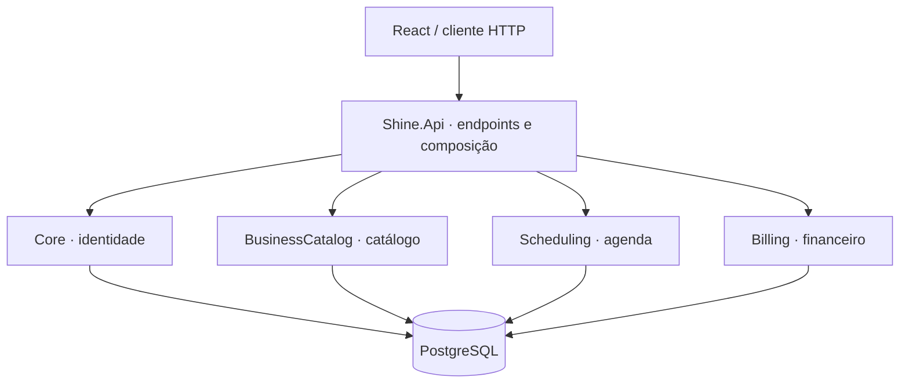

# Shine · Backend

API de uma plataforma de gestão de serviços com **ASP.NET Core, .NET 10 e PostgreSQL**. Um monólito modular que reúne identidade, catálogo de serviços, agendamento e faturamento.

> **Projeto de portfólio.** A iniciativa comercial foi encerrada. O projeto preserva a implementação e as decisões técnicas, sem oferta comercial, SLA ou compromisso de manutenção para produção.

[Frontend](https://github.com/Shine-Solucoes-Tecnologicas/Shine-Frontend) · [API](docs/api/README.md) · [Arquitetura](docs/architecture.md) · [Contribuição](CONTRIBUTING.md)

## Destaques técnicos

| Área | Implementação |
| --- | --- |
| Organização | Domain, Application e Infrastructure por módulo; limites verificados por testes |
| Identidade | Autenticação, autorização, recuperação de senha e sessões web |
| Múltiplas unidades | Seleção de tenant e escopos de acesso explícitos |
| Agenda | Disponibilidade, capacidade, agendamentos e lembretes |
| Catálogo | Serviços, profissionais e recursos do negócio |
| Financeiro | Contratos, assinaturas, registros financeiros e webhooks |
| Persistência | Entity Framework Core, migrations e PostgreSQL |
| Qualidade | Testes unitários, de integração e de arquitetura; CI e verificações de segurança |

Esses destaques descrevem código presente, não uma certificação de prontidão para produção. O frontend ainda não expõe todos os módulos. Entregas de e-mail em desenvolvimento usam simulação; integrações externas dependem de configuração.

## Arquitetura



Cada módulo mantém regras e testes próprios. Integrações usam contratos, eventos ou portas explícitas; módulos não referenciam outros módulos diretamente. Veja as [regras de dependência](docs/architecture.md) e as [decisões de persistência](docs/persistence.md).

## Executar localmente

Pré-requisitos: SDK **.NET 10.0.400** (ou patch compatível com `global.json`) e Docker com Compose.

Clone também o frontend no diretório irmão `Shine-Frontend`. Na raiz deste repositório, em PowerShell:

```powershell
./scripts/Local-Environment.ps1 -Action Prepare
./scripts/Local-Environment.ps1 -Action RunApi
```

Em outro terminal, inicie o frontend:

```powershell
./scripts/Local-Environment.ps1 -Action RunFrontend
```

A API atende em `http://localhost:5098`, o frontend em `http://localhost:5173` e `GET /health` confirma as dependências da API. `Prepare` aguarda o PostgreSQL, restaura e compila o backend e aplica, de forma reexecutável, as migrations de Core, Scheduling, Business Catalog e Billing nessa ordem. Ele não remove volumes nem executa migrations destrutivas fora das que já foram versionadas e revisadas.

A CI executa o mesmo `Prepare` em um volume vazio antes da suíte de regressão, cobrindo continuamente a criação dos quatro contextos a partir de um clone limpo.

Se o PostgreSQL não estiver disponível, execute `./scripts/Local-Environment.ps1 -Action Check`; o comando falha com o estado do Compose e orienta a consulta dos logs antes de testes ou migrations. Os valores acima são exclusivos do ambiente local. As configurações de desenvolvimento incluem chaves ilustrativas e entregas simuladas; use segredos próprios fora desse ambiente.

Para encerrar os serviços sem apagar os dados: `./scripts/Local-Environment.ps1 -Action Stop`. API e frontend rodam em primeiro plano e podem ser encerrados com `Ctrl+C` nos respectivos terminais.

### Dataset de demonstração

O dataset fictício usa exclusivamente o banco local `shine_demo`. Informe uma senha temporária em memória; ela não é gravada no repositório nem exibida pelo script:

```powershell
$demoPassword = Read-Host 'Senha local das contas demo' -AsSecureString
./scripts/Demo-Data.ps1 -Action Seed -Password $demoPassword
```

As três contas usam a mesma senha informada: `admin.demo@example.test` acessa as duas unidades, `viewer.demo@example.test` visualiza somente **Aurora Centro** e `editor.demo@example.test` opera somente **Aurora Jardins**. O acesso passa pela autenticação e seleção de unidade normais da API; não existe bypass HTTP.

O seed inclui profissionais, serviços, associações, clientes, disponibilidade de segunda a sexta e compromissos agendado, confirmado e cancelado. As datas são calculadas a partir do próximo dia útil em `America/Sao_Paulo`. Antes de uma nova apresentação, use o reset para renovar as datas:

```powershell
./scripts/Demo-Data.ps1 -Action Reset -Password $demoPassword -ConfirmReset shine_demo
```

O reset é destrutivo somente para `localhost/shine_demo`, exige a confirmação exata acima, recria migrations e reaplica o seed. A aplicação recusa seed em outro banco, host externo, ambiente diferente de Development ou sem habilitação explícita.

## Validar

```powershell
dotnet build Shine.Backend.slnx --configuration Release
dotnet test Shine.Backend.slnx --configuration Release --no-build
```

Os testes de integração exigem PostgreSQL e configuração da conexão. Consulte o [isolamento dos bancos de teste](docs/testing/integration-database-isolation.md). Nunca aponte testes para um banco de produção.

## Explore o código

```text
host/Shine.Api/            Endpoints, autenticação e composição HTTP
platform/Core/            Identidade, autorização e capacidades centrais
platform/Shared/          Tipos mínimos compartilhados
modules/BusinessCatalog/  Catálogo de serviços e profissionais
modules/Scheduling/       Agenda e disponibilidade
modules/Billing/          Contratos e financeiro
tests/                    TestKit e testes de arquitetura
docs/                     Contratos, decisões e operação
```

## Documentação

- [Inventário e convenções da API](docs/api/README.md)
- [Configuração](docs/configuration.md) e [sessão web](docs/security/web-session.md)
- [Entitlements e limites](docs/entitlements.md)
- [OpenAPI e compatibilidade](docs/openapi.md)
- [Workers, eventos e operação](docs/runtime-and-operations.md)
- [Implantação e segurança](docs/deployment-security.md) e [CI](docs/security-ci.md)

## Uso do código

Disponibilizado para apresentação e consulta. Nenhuma licença de código aberto foi concedida; consulte [NOTICE.md](NOTICE.md). Para relatar vulnerabilidades, veja [SECURITY.md](SECURITY.md).
